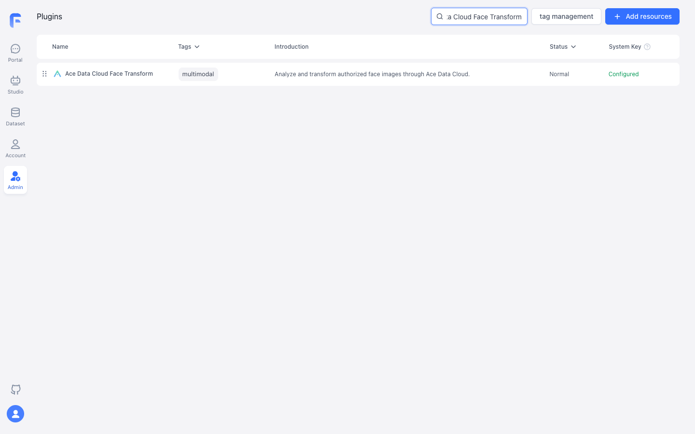
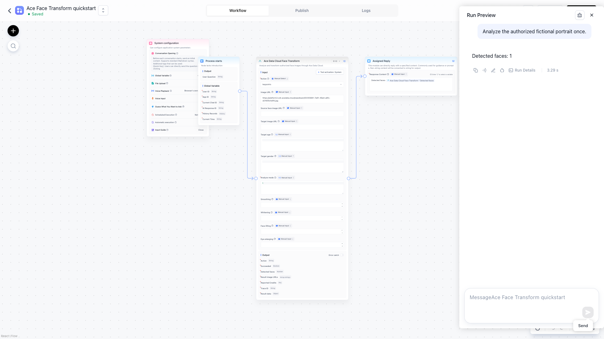

# Ace Data Cloud 人脸处理工具 for FastGPT

[English guide](README.md) · [当前价格](https://platform.acedata.cloud/models?utm_source=opensource&utm_medium=referral&utm_campaign=evergreen&utm_content=facetransformfastgpt_readme_pricing)

本插件支持人脸关键点、美化、年龄变化、性别变化、换脸、卡通化和活体迹象检测。只处理你拥有或获授权的图像。API 目前处于 Alpha；活体结果不能单独证明身份。

## 从零开始

1. 使用 FastGPT 4.15 或更新版本。上架后在插件市场搜索 **Ace Data Cloud Face Transform**，核对作者是 **Ace Data Cloud**。上架前，企业版或自部署管理员可构建并上传本仓库 .pkg；FastGPT 云服务目前不支持用户直接上传自定义插件。
2. 登录 [Ace Data Cloud 应用管理](https://platform.acedata.cloud/console/applications?utm_source=opensource&utm_medium=referral&utm_campaign=evergreen&utm_content=facetransformfastgpt_readme_api_key)，打开 **General Application**，确认 Face Transform 权限、余额和当期价格。下图 **1** 是复制 API Key；**2 Manage Keys → Create** 可新建 FastGPT 专用密钥。启用 Allowed APIs 时，仅允许计划使用的 /face/analyze、/face/beautify、/face/change-age、/face/change-gender、/face/swap、/face/cartoon、/face/detect-live。

3. 在 FastGPT 插件配置的 **Ace Data Cloud API key** 只填令牌本身，不加 Bearer 或引号，也不要放进提示词或工作流导出。
4. 在 **Studio → Create Agent → Workflow** 新建工作流。从 **System Tools** 添加 **Ace Data Cloud Face Transform**，激活工具并选择已配置的 **System secret**，连接 **Process starts → Ace Data Cloud Face Transform → Basic / Assigned Reply**。Action 选 keypoints，Analyze mode 填 1（最大的人脸），Image URL 填 https://platform2.cdn.acedata.cloud/seedream/00355681-7e81-49a4-a8fc-d2165fe1e9fd.jpg。这是此前生成的虚构人物测试图；也可换成自己有权处理、可访问的 HTTPS 图片。
5. 在 **Assigned Reply** 中用变量选择器插入 success、faceCount、data、costCredits、traceId。选择 **Save Only**，再用 **Run Preview** 执行一次。检测到人脸时 faceCount 至少为 1，关键点在 data 中。本工具同步返回，不需要任务 ID 或轮询。到 Ace Data Cloud 请求记录核对调用与 Credits；HTTP 成功也可能得到 faceCount=0。

以下截图展示插件安装，以及 **FastGPT Run Preview 中一次新调用**的结果。

## 无密钥示例

[examples/analyze.json](examples/analyze.json) 不含密钥。将真实密钥写入本地 .secrets.local.json，内容为 {"apiKey":"YOUR_OWN_KEY"}，然后运行：

~~~sh
pnpm install
pnpm exec fastgpt-plugin debug . --run --input-file examples/analyze.json --secrets-file .secrets.local.json
pnpm exec fastgpt-plugin build --entry . --output ./dist
pnpm exec fastgpt-plugin check --entry . --output ./dist
pnpm exec fastgpt-plugin pack --entry . --dist ./dist --output ./out
~~~

密钥文件已由 Git 忽略，不要提交或截图。其他动作分别使用：beautify 需 Image URL，可选 0–100 的美化强度；age 需 Image URL 和 Target age；gender 需 Image URL 和 Target gender（0 男转女、1 女转男）；swap 需经授权的 Source face image URL 和 Target image URL；cartoon 与 liveness 需 Image URL。每个动作是一次独立计费 API 调用。换脸同步等待最多 90 秒；超时后先查请求记录再决定是否重试。

401/403 检查密钥、权限和余额；400 检查动作必填项与 HTTPS 图像；429 降低并发；5xx 或超时先查原请求记录。客服只需可用的 traceId，不需要密钥。活体检测不能单独用于身份判定。

插件只向 api.acedata.cloud 发送所选图像 URL、参数和令牌。[隐私说明](PRIVACY.md) · [源码与问题反馈](https://github.com/AceDataCloud/FaceTransformFastGPT/issues)。
